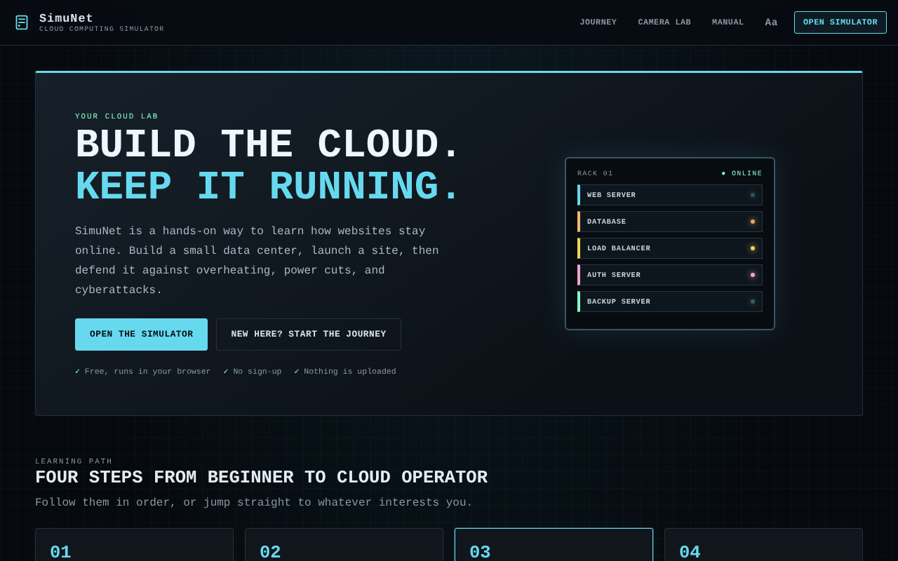
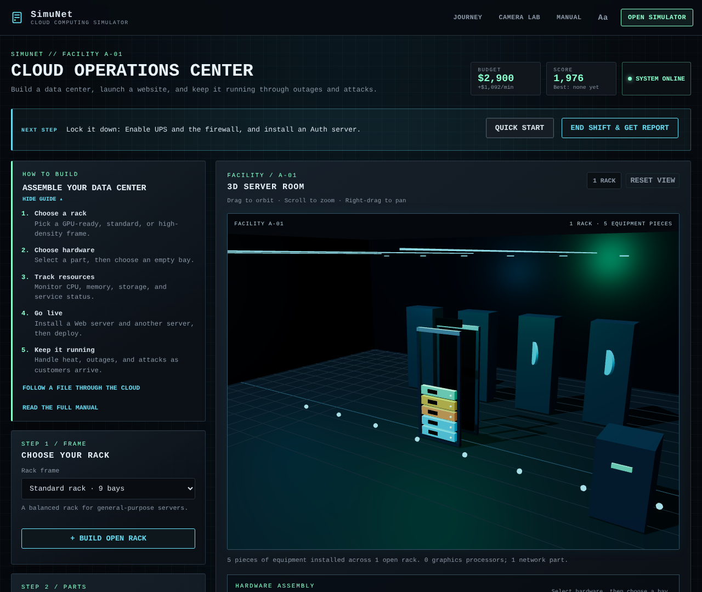
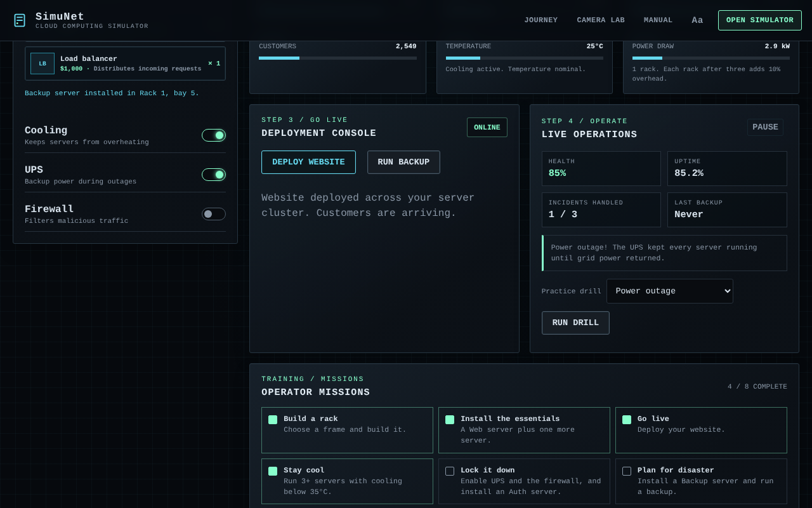
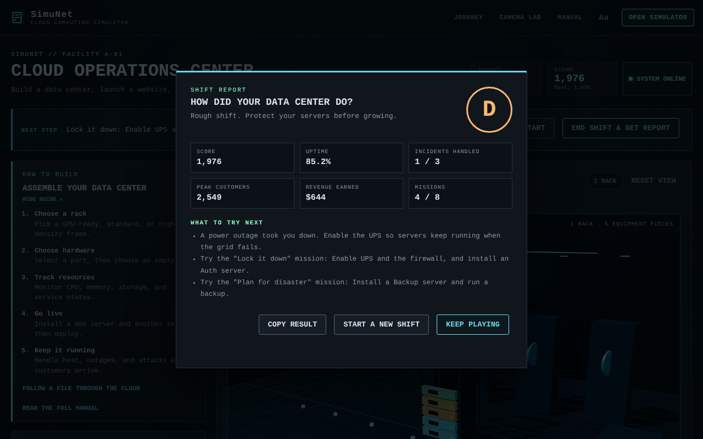
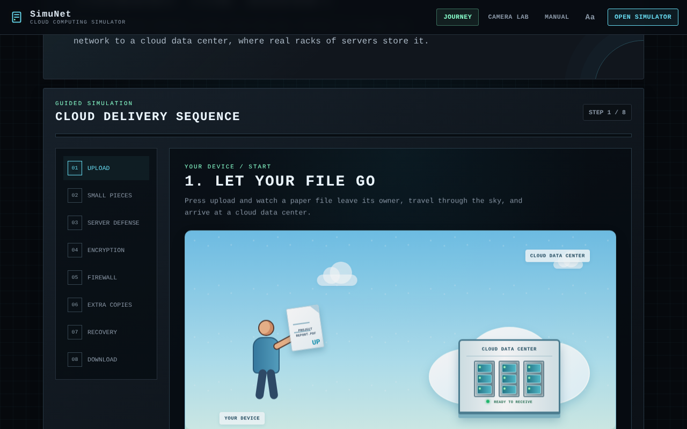

# SimuNet: Cloud Computing Simulator

**Build a data center. Launch a website. Keep it alive.**

SimuNet is a free, browser-based game that teaches how the cloud really works. Players spend a budget on servers, deploy a website, and then have to keep it running through overheating, power outages, cyberattacks, disk failures, and viral traffic spikes. Every incident explains what happened and what would have prevented it.

**▶ Play it now: https://da-cool-devs.github.io/Simunet/**

No sign-up, no install, and nothing is uploaded. It runs entirely in your browser.



---

## Why we built it

"The cloud" is invisible to most people. Words like *firewall*, *load balancer*, *backup*, or *uptime* are abstract until something breaks. SimuNet makes those ideas concrete: you build the infrastructure yourself, then watch what happens when it's under pressure. Learning comes from cause and effect, not from reading definitions.

## Try it in 60 seconds

1. Open the [Simulator](https://da-cool-devs.github.io/Simunet/simulator/).
2. Select **Quick start**. A starter data center is built and deployed for you.
3. Watch customers and revenue grow. Then choose **Run drill → Power outage** and see your site go down.
4. Turn on **UPS**, run the drill again, and watch it survive.
5. Select **End shift & get report** for your grade and personalised tips.

---

## Features

### 🏗️ Cloud Operations Center (the simulator)



- **Interactive 3D server room** (Three.js). Racks, servers, cooling units, and the UPS appear as you build them. Data packets flow while your site is live, the room glows red when overheating, flashes green or red on incidents, and goes dark during an outage.
- **Hands-on building.** Choose Standard, GPU-ready, or High-density racks and install 9 kinds of hardware by drag-and-drop or tap.
- **Real budget.** Start with $8,000. Hardware costs money, customers pay revenue every second, and power, cooling, UPS, and the firewall all have running costs.
- **Live simulation.** Temperature, power draw (with rack overhead), CPU load against capacity, customer growth, health, and uptime.
- **Five incident types** that strike at random, each with a matching defense:

  | Incident | Defense |
  | --- | --- |
  | Power outage | UPS |
  | Traffic flood (DDoS) | Firewall + Load balancer |
  | Password attack | Auth server + Firewall |
  | Disk failure | Backup server + recent backup |
  | Viral traffic spike | More capacity (Web servers, Database, Load balancer) |

- **Practice drills** to trigger any incident on demand.
- **Eight Operator Missions** that guide players from "Build a rack" to "Serve 5,000 customers".
- **Next-step coach** that always tells players what to do next.



### 🏆 Shift report

End your shift to get a letter grade (A–F), your stats, and tips based on what actually went wrong in *your* game. Your best score is saved, and **Copy result** creates a shareable summary.



### 🧭 Cloud Journey

An 8-step illustrated lesson that follows one file through the cloud: upload, packets, server defense, encryption, firewall (try it as both attacker and defender), replicas, recovery, and download. It ends with a **3-question knowledge check** that explains every answer.



### 📷 Camera Lab

Take a photo with your device camera and watch a copy travel from camera to network to server rack to hard drive. The photo never leaves your device.

### 📖 Manual

A beginner guide to every part, control, and metric, plus an incident table and an explanation of the budget and scoring.

### ♿ Accessibility

- Dark, light, and high-contrast themes, adjustable text size and font, and a reduced-motion mode. Settings are saved and apply site-wide, including the 3D room.
- Keyboard access throughout, with a skip link, focus styles, and keyboard-operable rack bays.
- Screen-reader labels, live status announcements, and a text fallback if 3D/WebGL isn't available.
- Responsive from phone to desktop.

---

## How it works

| | |
| --- | --- |
| **Stack** | Plain HTML, CSS, and JavaScript. No build step, no framework. |
| **3D** | [Three.js](https://threejs.org/) 0.180, loaded from a CDN via an import map |
| **Hosting** | GitHub Pages |
| **Storage** | `localStorage` only (accessibility preferences and best score) |

```
index.html            Home page
simulator/            Cloud Operations Center
journey/  journey.js  Cloud Journey lesson + quiz
camera/   camera.js   Camera Lab
manual/               Beginner manual
about/  accessibility/  404.html
script.js             Simulation engine: economy, incidents, missions, scoring
js/room3d.js          3D server room
js/accessibility.js   Theme, text size, font, motion, link preferences
js/site.js            Mobile navigation
style.css             All styles
```

### Run it locally

The site uses absolute `/Simunet/` paths, so start a server in the folder that *contains* your `Simunet` clone:

```bash
git clone https://github.com/Da-Cool-Devs/Simunet.git
python3 -m http.server 8000
```

Then open http://localhost:8000/Simunet/.

---

## Team

Built by **Da Cool Devs**. See [CONTRIBUTING.md](CONTRIBUTING.md) to get involved and [CHANGELOG.md](CHANGELOG.md) for what's new.

## License

Released into the public domain under [The Unlicense](LICENSE).
